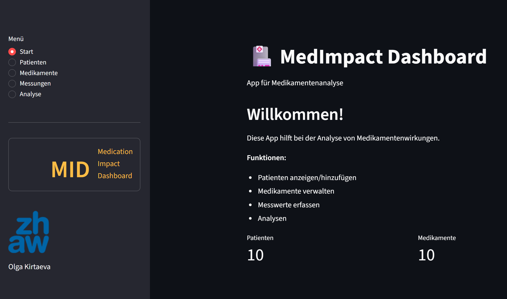
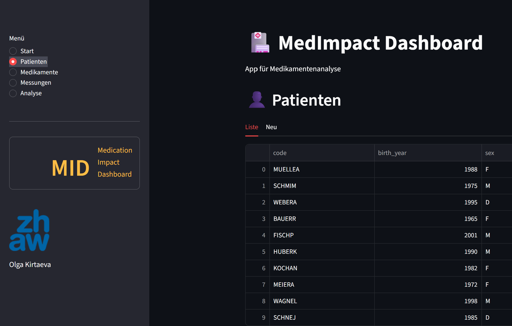
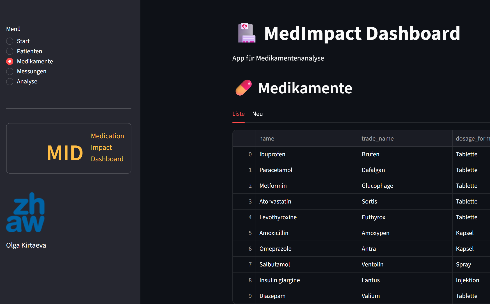
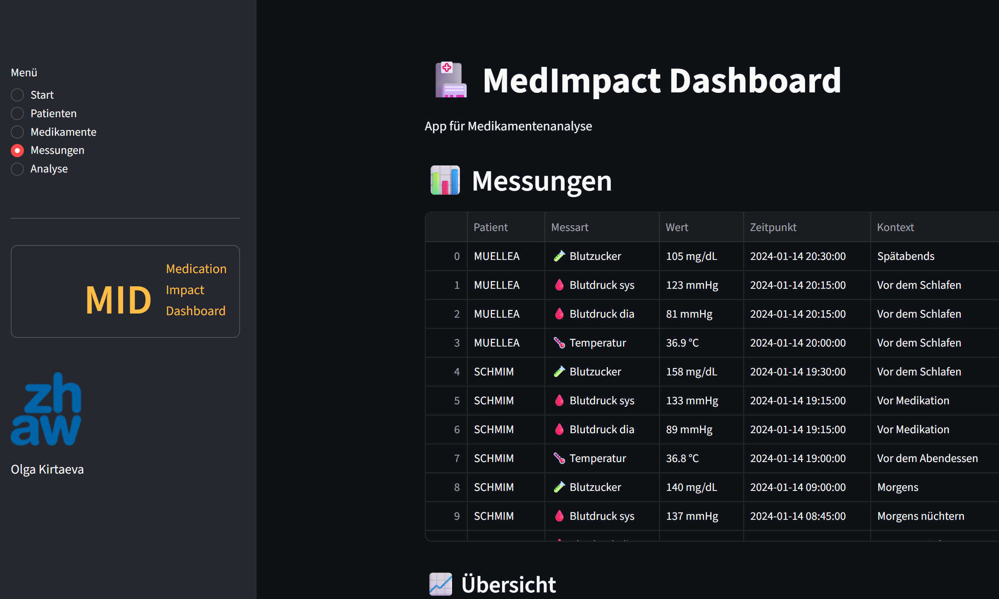
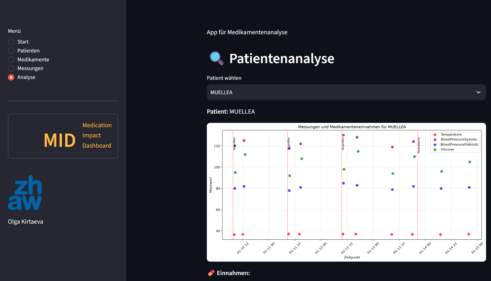
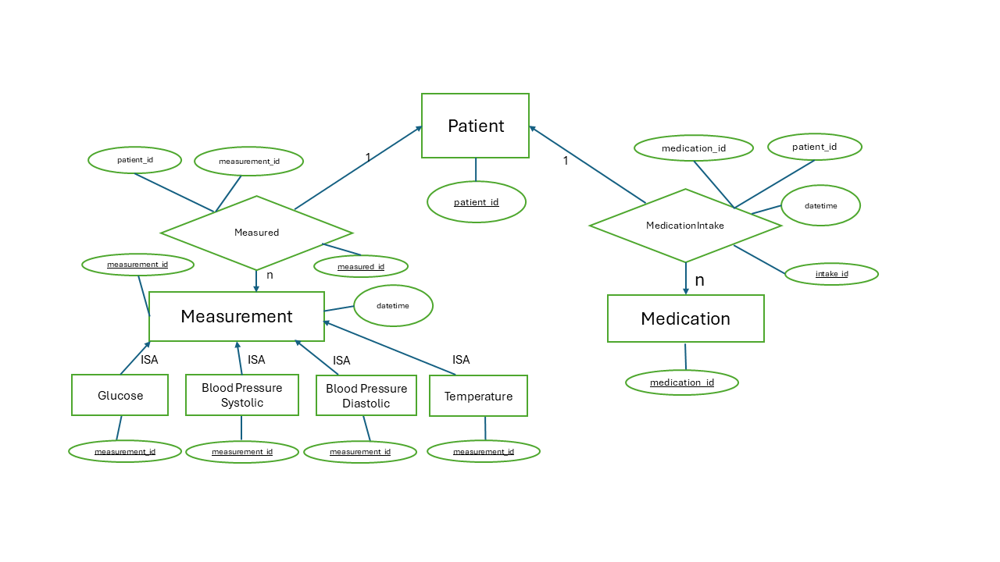

# MID - MedImpact Dashboard

- Kirtaeva Olga

## Projektidee

Das Ziel dieses Programms ist die Analyse der Korrelation zwischen der Einnahme von Medikamenten und physiologischen Messungen. Es kann bei der Durchführung klinischer Studien für neue Arzneimittel 
oder bei der individuellen Therapieauswahl für Patienten eingesetzt werden.












## ER Modell MedImpact Dashboard

- Beschreibung (welche Entitätstypen, welche Beziehungstypen, wie sind die Kardinalitäten etc)

ÜBERSICHT DER ENTITÄTSTYPEN
---------------------------

KERENTITÄTSTYPEN (INDEPENDENT ENTITY TYPES):
1. Patient
   - patient_id (PK), code, birth_year, sex
2. Medication
   - medication_id (PK), name, trade_name, dosage_form
3. Measurement
   - measurement_id (PK)

BEZIEHUNGSTABELLEN (RELATIONSHIP TABLES):
4. MedicationIntake
   - intake_id (PK), patient_id (FK), medication_id (FK)
   - datetime, dose
5. Measured
   - measured_id (PK), patient_id (FK), measurement_id (FK)
   - measured_datetime, context

ISA-ABHÄNGIGE MESSUNGSTYPEN (SPEZIALISIERUNGEN):
6. Temperature
   - measurement_id (PK+FK), value, einheit, method
7. BloodPressureSystolic
   - measurement_id (PK+FK), value, einheit, position
8. BloodPressureDiastolic
   - measurement_id (PK+FK), value, einheit
9. Glucose
   - measurement_id (PK+FK), value, einheit, glucose_type
   - fasting_status, time_since_meal


BEZIEHUNGSTYPEN UND KARDINALITÄTEN
-----------------------------------

1. PATIENT ↔ MEDICATION (VIA MEDICATIONINTAKE):
   Patient (1) <-  MedicationIntake (m) -> Medication (m)
   - Beziehung: "Patient nimmt Medikament ein"
   - Kardinalitäten: m:n
   - Schlüssel: UNIQUE(patient_id, medication_id, datetime)

2. PATIENT ↔ MEASUREMENT (VIA MEASURED):
   Patient (1) <- Measured (1) с Measurement (1)
   - Beziehung: "Patient hat Messung"
   - Kardinalitäten: 1:1 via Measured
   - Schlüssel: UNIQUE(measurement_id)

3. MEASUREMENT → SPEZIFISCHE MESSUNGEN (ISA):
   Measurement (1) <-ISA -> Temperature (1)
   Measurement (1) <-ISA -> BloodPressureSystolic (1)
   Measurement (1) <-ISA -> BloodPressureDiastolic (1)
   Measurement (1) <-ISA -> Glucose (1)
   - Beziehung: "Ist-ein"
   - Kardinalitäten: ISA
   - Schlüssel: PK der Kindtabelle = FK zur Elterntabelle


ER-DESIGN MODELL
-----------------------------------

KORREKTE ER-DIAGRAMM-REGELN:
1. Alle Pfeile sind Existenzabhängigkeiten → FOREIGN KEY Constraints
2. "1"-Label → UNIQUE Constraint auf alle anderen Fremdschlüssel
3. "m"-Label → keine zusätzliche Constraint
4. "ISA"-Label → FK ist UNIQUE (identisch mit PK)
5. Keine NULLs in Fremdschlüsseln → alle FK sind NOT NULL
6. Beziehungen immer als separate Tabellen (auch bei 1:N)

BEISPIEL-SQL:
CREATE TABLE Temperature (
    measurement_id INTEGER PRIMARY KEY,
    value DECIMAL(5,2) NOT NULL,
    einheit TEXT NOT NULL DEFAULT '°C',
    method TEXT CHECK(method IN ('oral', 'axillary', 'rectal', 'tympanic', 'temporal')),
    created_at TIMESTAMP DEFAULT CURRENT_TIMESTAMP,
    FOREIGN KEY (measurement_id) REFERENCES Measurement(measurement_id)
);

CREATE TABLE MedicationIntake (
    intake_id SERIAL PRIMARY KEY,
    patient_id INTEGER NOT NULL,
    medication_id INTEGER NOT NULL,
    datetime TIMESTAMP NOT NULL,
    dose TEXT NOT NULL,
    notes TEXT,
    created_at TIMESTAMP DEFAULT CURRENT_TIMESTAMP,
    FOREIGN KEY (patient_id) REFERENCES Patient(patient_id),
    FOREIGN KEY (medication_id) REFERENCES Medication(medication_id),
    UNIQUE(patient_id, medication_id, datetime)
);

KORRELATIONSANALYSE-LOGIK
--------------------------

DATENVERKNÜPFUNG:
Patient → MedicationIntake → Medication
   ↓
Measured → Measurement → [Temperature|BloodPressure|...]

BEISPIEL-QUERY:
S-- Einfacher Korrelationsquery für PostgreSQL
SELECT 
    p.code as patient,
    mi.datetime as einnahme,
    md.measured_datetime as messung,
    t.value as temperatur,
    EXTRACT(EPOCH FROM (md.measured_datetime - mi.datetime)) / 3600 
        as stunden_nach
FROM Patient p
JOIN MedicationIntake mi ON p.patient_id = mi.patient_id
JOIN Medication m ON mi.medication_id = m.medication_id
JOIN Measured md ON p.patient_id = md.patient_id
JOIN Measurement ms ON md.measurement_id = ms.measurement_id
    AND ms.measurement_type = 'Temperature'
JOIN Temperature t ON ms.measurement_id = t.measurement_id
WHERE m.name = 'Ibuprofen'
  AND md.measured_datetime >= mi.datetime
  AND md.measured_datetime <= mi.datetime + INTERVAL '4 hours'
ORDER BY p.code;

VORTEILE DIESES DESIGNS
-----------------------

FÜR WISSENSCHAFTLICHE PROJEKTE:
1. Vollständige Normalisierung → IDNF
2. Keine NULL-Probleme an kritischen Stellen
3. Klare Semantik → jeder Pfeil = Existenzabhängigkeit
4. Flexible Erweiterbarkeit → neue Messungstypen als neue ISA-Tabellen

FÜR DIE PRAXIS:
1. Korrelationsanalyse durch explizite Zeitstempel
2. Einheitenbehaftete Werte → einheit in jeder Messungstabelle
3. Historisierung durch Zeitstempel in Beziehungstabellen
4. Referentielle Integrität durch FOREIGN KEY Constraints




## Beschreibung der Streamlit-App
Der Streamlit-App ermöglicht die interaktive Analyse der Korrelation zwischen 
Medikamenteneinahmen und physiologischen Messungen. Sie bitet ein benutzefreundliches 
Daschboard für Kliniker und Forscher.

Wichtig sind folgende zwei Punkte:

### 1. Eingabeformular (was wird erfasst?)
Die App hat zwei Haupt-Eingabeformulare für verschiedene Datentypen:
**A. Patienten-Formular**
"""
👤 NEUER PATIENT ERFASSEN
────────────────────────
Eingabefelder:
1. Patientencode (Text) - z.B. "P001", "MUSTERM"
2. Geburtsjahr (Zahl) - zwischen 1900-2024
3. Geschlecht (Dropdown) - Auswahl: Männlich (M), Weiblich (F)
"""
**B. Medikamenten-Formular**
"""
💊 NEUES MEDIKAMENT ERFASSEN
────────────────────────────
Eingabefelder:
1. Wirkstoffname (Text) - z.B. "Ibuprofen", "Metformin"
2. Handelsname (Text, optional) - z.B. "Brufen", "Glucophage"
3. Darreichungsform (Dropdown) - Auswahl: Tablette, Kapsel, Saft, Injektion, Creme
"""

### 2. Datenanzeige (welche Abfrage wird angezeigt?)
Die App zeigt Daten in verschiedene Tabellen an:
**A. Abfrage für Patientenliste**
**B. Medikamenten-Liste**
**C. Messungen**

**. Die App zeigt Daten in Diagrammen an bei der Patientenanalyse**

## Auführen der App
Tabellen-Format
Statistik-Boxen
Punkt-Diagramm: Korrelation Zeit vs. Messwert


**Beispiel für einen kompletten Workflow:**
Schritt 1: Patient anlegen
Formular: P002, 1985, M
→ INSERT INTO Patient VALUES ('P002', 1985, 'M')

Schritt 2: Medikament anlegen
Formular: Paracetamol, Benuron, Tablette
→ INSERT INTO Medication VALUES ('Paracetamol', 'Benuron', 'Tablette')

Schritt 3: Daten anzeigen
SELECT ... JOIN ... → Zeigt: "P002 hatte 2h nach Paracetamol 36.8°C"

Schritt 4: Patientenanalyse anzeigen


**Wichtig:** Testet dass folgende Schritte funktionieren:

1. `pip install -r requirements.txt`
2. `python setup_db.py`
3. `streamlit run streamlit_app.py`


## Lokal starten mit SQLite (ohne Datenbankserver)

SQLite ist bereits in Python enthalten. PostgreSQL, Zugangsdaten und eine
Internetverbindung zur Datenbank sind nicht erforderlich.

```powershell
python -m pip install -r requirements.txt
python setup_db.py
python -m streamlit run streamlit_app.py
```

Beim ersten Start entsteht `data/medimpact.sqlite3` automatisch, inklusive
Tabellen und Beispieldaten aus `sample_data.sql`. `setup_db.py` ist optional;
weitere Starts behalten vorhandene Daten und laden die Beispiele nicht erneut.
Alle Dateipfade beziehen sich auf den Projektordner, unabhängig vom Arbeitsordner.
Zum Sichern genügt eine Kopie der Datenbankdatei bei geschlossener Anwendung.

Das ursprüngliche PostgreSQL-Setup und die geänderten SQL-Zeilen bleiben als
Kommentare erhalten. `create_tables.sql` bleibt unverändert als PostgreSQL-Vorlage;
SQLite verwendet `create_tables_sqlite.sql`. `.streamlit/secrets.toml` wird im
lokalen Modus nicht gelesen. Eine vorhandene PostgreSQL-Datenbank wird nicht
verändert oder automatisch importiert.
